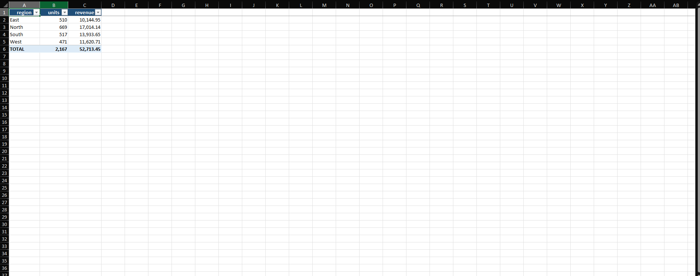

# Report Merger

Combine a folder of weekly (or monthly) CSV and Excel reports into one formatted Excel workbook with totals.

## The problem

Many small businesses get a new report file every week, then spend time copying and pasting them into one spreadsheet to see the big picture. This script merges them all automatically and builds the summary for you.

## What you get

One Excel workbook with three sheets:

| Sheet | Contents |
|---|---|
| **Combined** | Every row from every file, a `source_file` column showing where each row came from, and a live-formula TOTAL row |
| **Summary** | Totals of each numeric column, optionally grouped by one or more columns (for example `region`) |
| **By File** | Totals per source file, so you can compare week to week |

Headers are styled, columns are auto-sized, the top row is frozen, filters are on, and totals use real Excel `SUM` formulas so the workbook stays editable.



## Installation

Requires Python 3.8+.

```bash
pip install pandas openpyxl
```

## Usage

```bash
# Merge every CSV/Excel file in a folder
python merge_reports.py weekly_reports/ -o summary.xlsx

# Merge specific files, with the summary grouped by region
python merge_reports.py week1.xlsx week2.csv week3.csv --group-by region

# Group by more than one column
python merge_reports.py reports/ --group-by "region,product"
```

Example output:

```
Merged 12 file(s), 3,480 rows -> /home/you/summary.xlsx
```

## Notes and limitations

- The files should share the same column names. Columns missing from a file are left blank for that file's rows.
- Columns stored as text but mostly numeric (for example `"$1,200"`) are converted to numbers automatically.
- Reading old `.xls` files may require `pip install xlrd`.
- If a `--group-by` column doesn't exist, the script stops and lists the available columns.

## License

MIT
